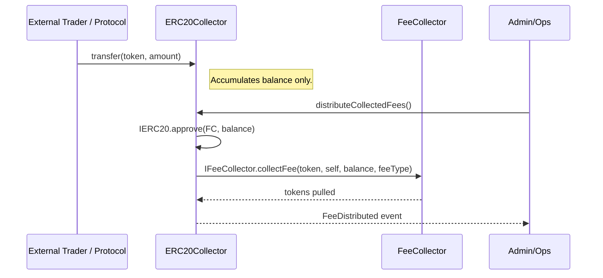

# ERC20Collector

## Overview
The **ERC20Collector** is a lightweight, generic fee-aggregation contract for any ERC-20 token.  
Instead of calling the expensive `FeeCollector.collectFee()` function on *every* token transfer, users and external
protocols simply transfer their fees to an **ERC20Collector** instance.  
The collector keeps no internal accounting apart from the token balance and, when instructed, forwards the entire
balance to the main [`FeeCollector`](FeeCollector.md) contract where the final distribution logic lives.

This pattern brings two major benefits:

1. **Gas Efficiency** – `collectFee` is invoked only once per distribution cycle instead of once per user trade / action.
2. **Ease of Integration** – external systems (AMMs, LP vaults, trading bots, etc.) do **not** need to integrate with
   the protocol-specific fee API. They can deposit fees with a simple `ERC20.transfer()` to a known address.
3. **Fee-on-Transfer Compatibility** – Because the downstream [`FeeCollector`](FeeCollector.md) correctly accounts for
   deflationary behaviour, the collector works with fee-on-transfer tokens (a.k.a. transfer-tax or rebasing tokens)
   out-of-the-box.

RAAC-specific collectors such as [`RAACTokenCollector`](RAACTokenCollector.md) and
`RWAIndexTokenCollector` are thin wrappers around this base contract that supply the proper token address and a
`bytes32` *feeType* identifier.

---

## Contract Details
| Item               | Value                                              |
|--------------------|----------------------------------------------------|
| **Contract Name**  | `ERC20Collector`                                   |
| **Inheritance**    | `AccessControl`, `ReentrancyGuard`                 |
| **Libraries Used** | `SafeERC20`                                        |
| **Source File**    | `contracts/core/collectors/ERC20Collector.sol`     |
| **License**        | BSL-1.1                                            |

### State Variables
| Variable            | Type     | Description |
|---------------------|----------|-------------|
| `feeCollector`      | address  | Destination `FeeCollector` contract that receives the aggregated balance. |
| `underlyingToken`   | address  | ERC-20 token handled by this collector. |
| `feeType`           | bytes32  | Identifier understood by the `FeeCollector` so it knows which "bucket" to credit. |
| `FEE_MANAGER_ROLE`  | bytes32  | Role hash that can perform management actions such as updating the `feeCollector`. |

### Access Control
The contract uses OpenZeppelin's `AccessControl` with two roles:

* `DEFAULT_ADMIN_ROLE` – assigned to the deployer, can grant/revoke other roles.
* `FEE_MANAGER_ROLE` – allowed to update the `feeCollector` address and rescue tokens.

---

## Core Functions
| Function | Visibility |Description |
|----------|------------|------------|
| `constructor(address _feeCollector, address _token, bytes32 _feeType)` | public | Sets immutable `feeType` and initial addresses. Grants admin & manager roles to deployer. Validation prevents zero-address inputs. |
| `setFeeCollector(address _feeCollector)` | external | Updates the destination `feeCollector` contract. `onlyRole(FEE_MANAGER_ROLE)` guarded. |
| `distributeCollectedFees()` | external | Transfers **entire** token balance to `feeCollector` and calls `IFeeCollector.collectFee(...)`. Emits `FeeDistributed`. Re-entrancy-protected. |
| `rescueToken(address token, address recipient, uint256 amount)` | external | Allows rescue of *non-main* assets accidentally sent to the contract. Blocked for `underlyingToken`. |

### Gas Flow Diagram

---

## Custom Errors
| Error | Trigger Condition |
|-------|------------------|
| `ApprovalFailed()` | Low-level `IERC20.approve()` returned `false`. |
| `InvalidAddress()` | Function received the zero address. |
| `NoFeesToDistribute()` | `distributeCollectedFees()` called with zero token balance. |
| `CannotRescueMainAsset()` | Attempt to rescue `underlyingToken`. |

---

## Design Rationale
1. **Batching vs. Per-Transfer Accounting**  
   Calling `collectFee` every time a fee is generated would require additional storage writes and event emissions,
   making transfers prohibitively expensive. By batching through `ERC20Collector` we reduce gas consumption to the
   minimum possible – a single approval and external call per distribution window.

2. **Third-Party Compatibility**  
   Many fee sources live outside the RAAC code-base (e.g. future AMMs, liquidity pools, OTC desks). Asking those
   contracts to integrate the full `FeeCollector` interface is unrealistic. Providing them with a simple deposit
   address enables seamless collection without code changes on their part.

3. **Flexible Distribution Strategy**  
   Because funds are sent in aggregate, operations such as time-weighted averaging, proportional splitting, or
   cross-asset conversion can occur **once** inside `FeeCollector`, keeping collector contracts stateless and
   upgrade-friendly.

---

## Integration Guidelines
1. **Deploy a dedicated collector per token** supplying:
   * `_feeCollector` – the central `FeeCollector` instance.
   * `_token` – ERC-20 token address.
   * `_feeType` – `keccak256("<MY_FEE_TYPE>")` agreed with `FeeCollector`.
2. Give the resulting address to external fee sources (DEX, vault, bot) as the recipient of their fee transfers.
3. At chosen intervals (hourly, daily, etc.) call `distributeCollectedFees()` from an operations account with
   `FEE_MANAGER_ROLE`.
4. Monitor `FeeDistributed` events to record the exact amount moved into the protocol treasury.

---

## Events
| Event | Parameters | Description |
|-------|------------|-------------|
| `FeeDistributed` | `(token, collector, amount, feeType)` | Emitted after successful forwarding of funds to `FeeCollector`. |
| `FeeCollectorSet` | `(collector)` | Emitted when a new `feeCollector` address is configured. |
| `TokenRescued` | `(token, recipient, amount)` | Emitted after a successful asset rescue. |

---

## Security Considerations
* **Reentrancy** – The `nonReentrant` modifier protects `distributeCollectedFees` even though the function uses
  approve-and-call pattern.
* **Role Leakage** – Keep `FEE_MANAGER_ROLE` tightly controlled; malicious changes could reroute fees.
* **Fee-On-Transfer Tokens** – `FeeCollector` is expected to handle deflationary tokens; the collector emits the
  *requested* amount, but actual received amount may differ after transfer tax.

---

## Testing Checklist
- Deploy mock ERC-20 and `FeeCollector`.
- Mint tokens to users and simulate fee transfers to `ERC20Collector`.
- Verify `distributeCollectedFees` rejects when balance is zero.
- Confirm `FeeCollector.collectFee` is called with correct arguments and total amount.
- Test rescue path for unrelated tokens.

---

## See Also
* [`RAACTokenCollector`](RAACTokenCollector.md) – concrete implementation for the RAAC governance token.
* `RWAIndexTokenCollector` – collector for the RWA index token fees. 